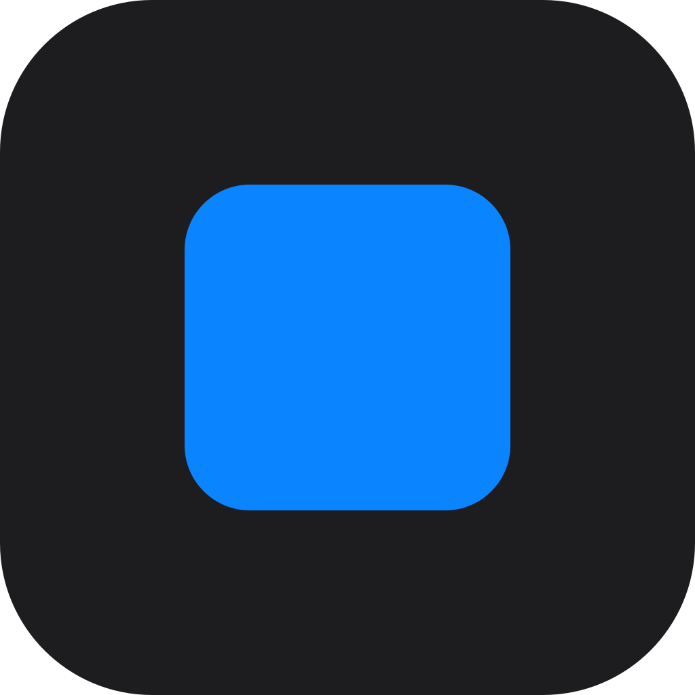
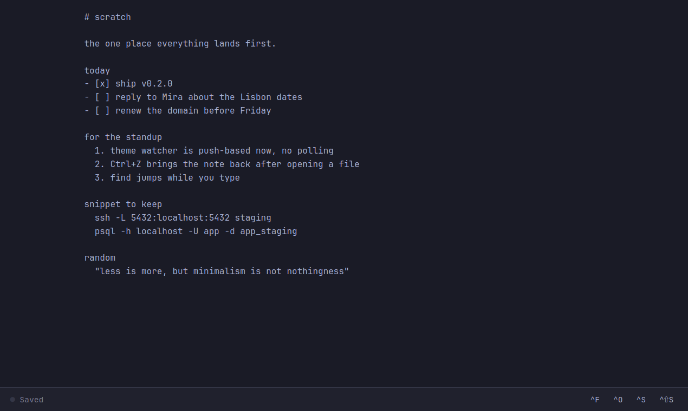
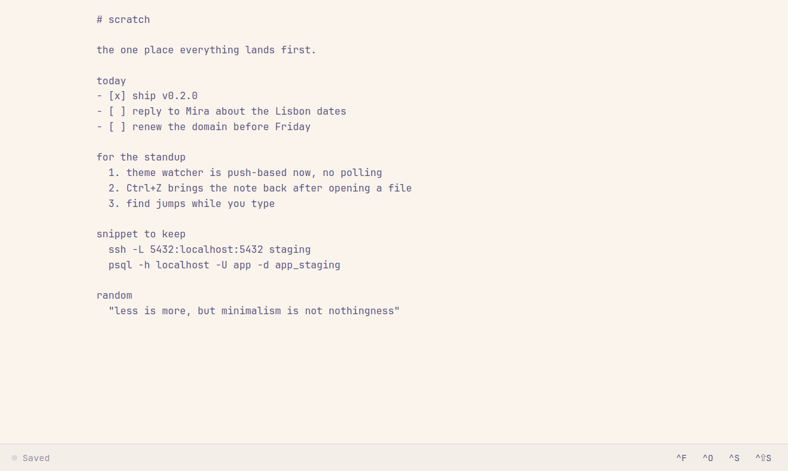
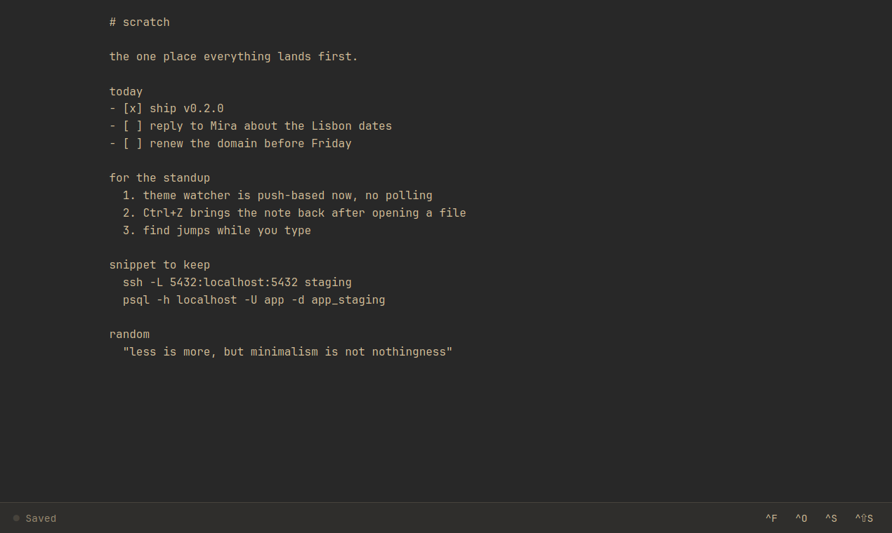
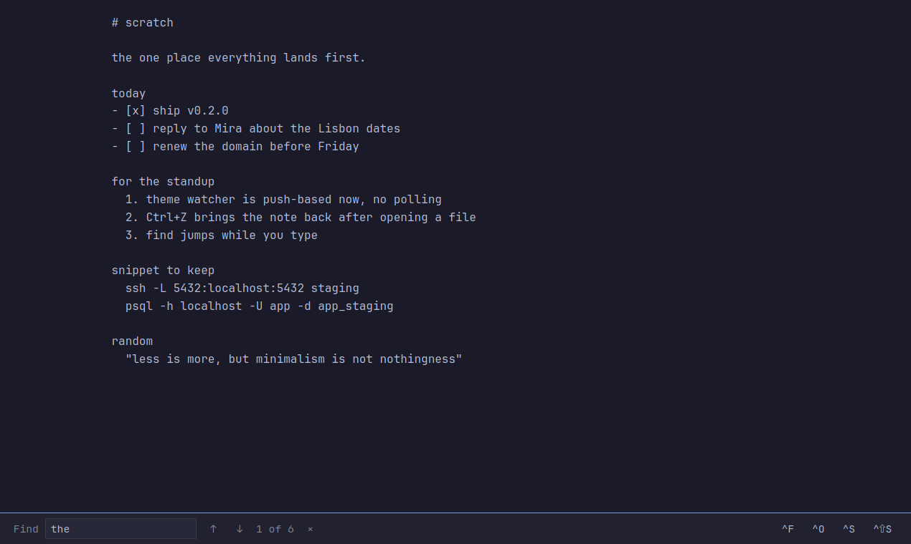

<div align="center">
  
  <h1>Scratch Pad</h1>
  <p><strong>The one note that is always open.</strong></p>
  <p>No files, no tabs, no title bar. Press a key, type, leave. It is still there tomorrow.</p>

  <p>
    
    
    
    
    
  </p>

  
</div>

---

Most notes apps start by asking where to put the note. Scratch Pad has exactly one, and it opens straight into it with the cursor ready: the phone number someone is reading out, the command you will need again in an hour, the list for today. When it has earned a file of its own, export it as Markdown and keep typing.

It is built for a tiling desktop. Hyprland draws the border and closes the window; Scratch Pad draws the text and four key hints, and nothing else.

## It wears your theme

Scratch Pad ships no colours of its own. It reads the active [Omarchy](https://omarchy.org) theme and your terminal's font size, and recolours the moment you switch theme, without a restart.

<table>
  <tr>
    <td></td>
    <td></td>
  </tr>
  <tr>
    <td align="center"><sub>Rosé Pine</sub></td>
    <td align="center"><sub>Gruvbox</sub></td>
  </tr>
</table>

Only three colours are taken from the theme (`background`, `foreground`, `accent`); borders, dim text and dialogs are mixed from them, so it works with any theme, including your own. Without Omarchy it follows the system's light or dark setting.

## What it does

- **Saves by itself.** After 10 seconds without typing, when the window loses focus, and when it closes. `Ctrl+S` saves at once. If a closing save fails, the window stays open and says so.
- **Stays out of the way.** No header, no decorations, no settings. The bar shows the save state and four keys: `^F` find, `^O` open, `^S` save, `^⇧S` export.
- **Reads well at any size.** On a wide tile the text keeps a centred column of about 100 characters; in a small floating window (down to 360x200) it uses every pixel.
- **Edits like an editor.** Tab and Shift+Tab indent, Enter keeps the indent and continues `-`, `1.` and `- [ ]` lists, and undo survives all of it.
- **Finds as you type.** `Ctrl+F` starts from the selected text and jumps to the first match while you type.
- **Opens and exports.** Load any UTF-8 text file (up to 10 MiB) into the note, and `Ctrl+Z` brings the old note back. Export as Markdown with a name taken from your first line and the date, such as `apikeys-14-11-2026.md`.
- **Keeps to itself.** No network access, no account, no telemetry. The note lives in `~/.local/share/com.scratch.pad/records.sqlite3`. File dialogs run in Rust, so the web view never sees a path on your disk.

<div align="center">
  
</div>

## Install

### From the release (Linux x86_64)

The prebuilt binary needs Wayland, glibc 2.39 or newer (current Arch, Fedora 40+, Ubuntu 24.04+), and two system libraries:

| Distribution | Command |
|---|---|
| Arch | `sudo pacman -S --needed webkit2gtk-4.1 gtk3` |
| Fedora | `sudo dnf install webkit2gtk4.1 gtk3` |
| Debian / Ubuntu | `sudo apt install libwebkit2gtk-4.1-0 libgtk-3-0` |

Then:

```bash
curl -LO https://github.com/nodaysidle/scratch-pad/releases/download/v0.2.0/scratch-pad-0.2.0-linux-x86_64.tar.gz
curl -LO https://github.com/nodaysidle/scratch-pad/releases/download/v0.2.0/scratch-pad-0.2.0-linux-x86_64.tar.gz.sha256
sha256sum -c scratch-pad-0.2.0-linux-x86_64.tar.gz.sha256
tar -xzf scratch-pad-0.2.0-linux-x86_64.tar.gz
./scratch-pad-0.2.0/install.sh
```

This puts the binary in `~/.local/bin/scratch-pad` and adds the icon and a launcher entry, so it shows up in your app launcher (on Omarchy: `Super + Space`). Nothing needs root. `./scratch-pad-0.2.0/install.sh --uninstall` removes it again and keeps your note.

It is developed and tested on Arch Linux with Hyprland (Omarchy). It should run on other Wayland desktops, where it falls back to the system's light or dark colours, but that is not tested.

### From source

Needs Node.js (`npm`), Rust 1.85+, and the two libraries above with their development files.

```bash
git clone https://github.com/nodaysidle/scratch-pad.git
cd scratch-pad
npm ci
./scripts/package_linux.sh --install-binary
```

The previous binary is kept in `dist/rollback/`. Launching Scratch Pad again focuses the running window instead of opening a second one.

> The AppImage target (`--install`) currently fails on Arch inside `linuxdeploy`; see [docs/BUILD-NOTES.md](docs/BUILD-NOTES.md).

## Hyprland setup

Keep the note opaque in Omarchy 4.5 (`~/.config/hypr/hyprland.lua`):

```lua
o.window({ class = "scratch-pad" }, { tag = "-default-opacity", opacity = "1.0 1.0" })
```

Optionally float it as a scratchpad:

```lua
o.window({ class = "scratch-pad" }, { tag = "+floating-window" })
```

## Keyboard

| Key | Action |
|---|---|
| `Ctrl+S` | Save the note now |
| `Ctrl+Shift+S` | Export the note as Markdown |
| `Ctrl+O` | Open a text file (replaces the note after confirmation; `Ctrl+Z` brings the old note back) |
| `Ctrl+F` | Find in the note |
| `Enter` / `Shift+Enter` | Next / previous match while find is open |
| `Ctrl+Shift+C` | Copy the whole note when nothing is selected |
| `Tab` / `Shift+Tab` | Indent / outdent the line or selection |
| `Enter` | New line with the same indent; continues `-`, `*`, `+`, `1.` and `- [ ]` lists (Enter on an empty item ends the list) |
| `F6` | Move focus between the note and the bar |
| `Esc` | Close find, cancel a confirmation, or dismiss an error |

## How the theme following works

The colours come from `~/.config/omarchy/current/theme/colors.toml`: `background`, `foreground` and `accent`, plus the optional `mode`, `selection_background` / `selection`, `selection_foreground` and `red` / `color1`. Everything else is derived in `src/style.css`. The accent is used only for the caret, focus and outlines.

Omarchy replaces the whole theme folder on a switch, so `src-tauri/src/platform/omarchy.rs` watches the folder above it and pushes an `omarchy-changed` event to the window, which keeps the last valid colours during the swap. The font size is read from your terminal's config (Ghostty, Alacritty, kitty or foot; 13px otherwise) and follows it the same way.

## Development

```bash
npm run tauri dev      # run with live reload
npm run check          # typecheck, Vitest, rustfmt, clippy, Cargo tests
```

- [docs/DEVELOPMENT.md](docs/DEVELOPMENT.md): repo layout, test status and project rules
- [docs/BUILD-NOTES.md](docs/BUILD-NOTES.md) and [docs/BUILD-REPORT.md](docs/BUILD-REPORT.md): packaging details
- [docs/specs/](docs/specs/): the original specification (`PRD`, `ARD`, `TRD`, `TASKS`)
- [docs/plans/](docs/plans/): the improvement plans, one per change
